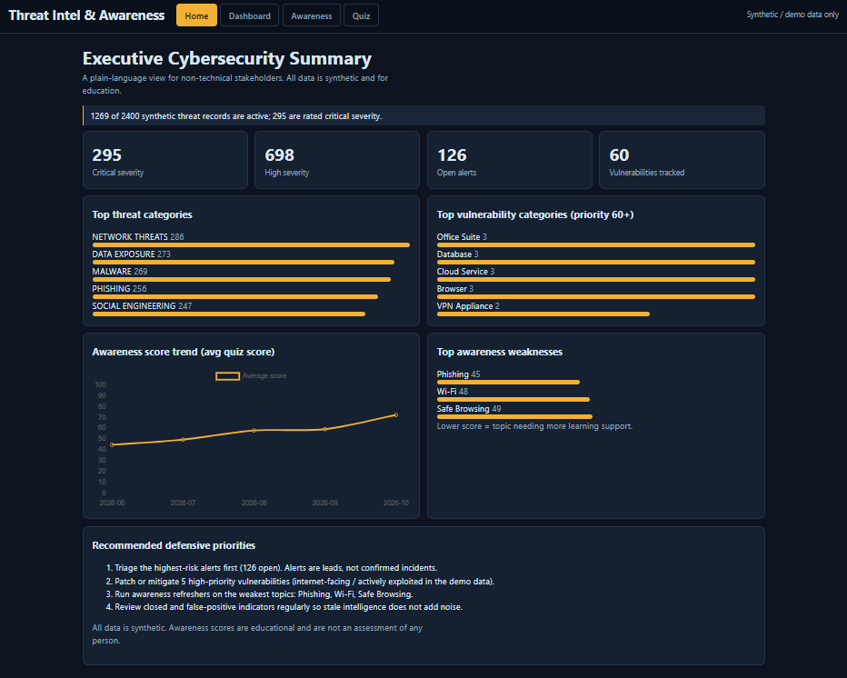
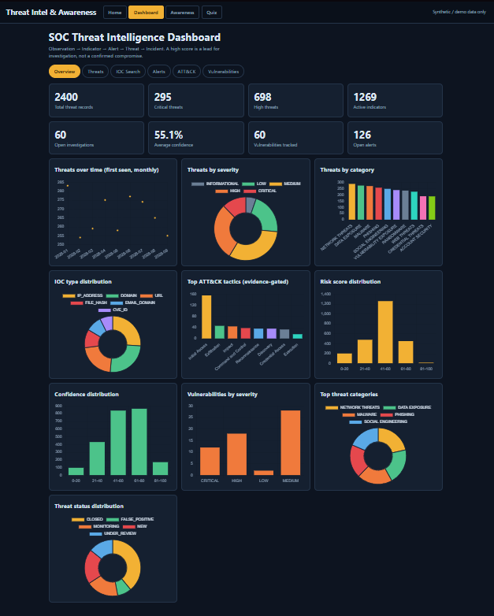
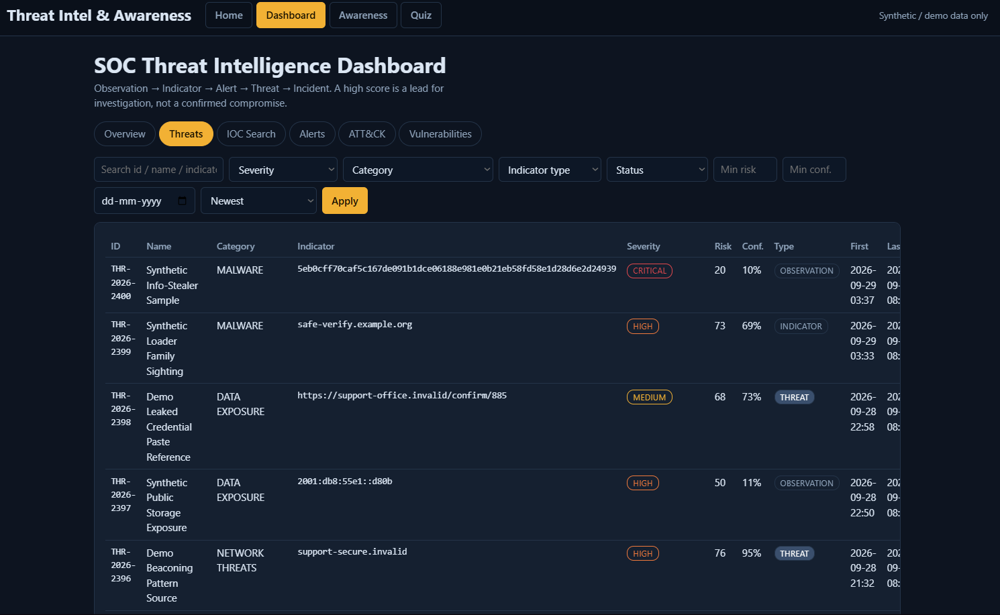
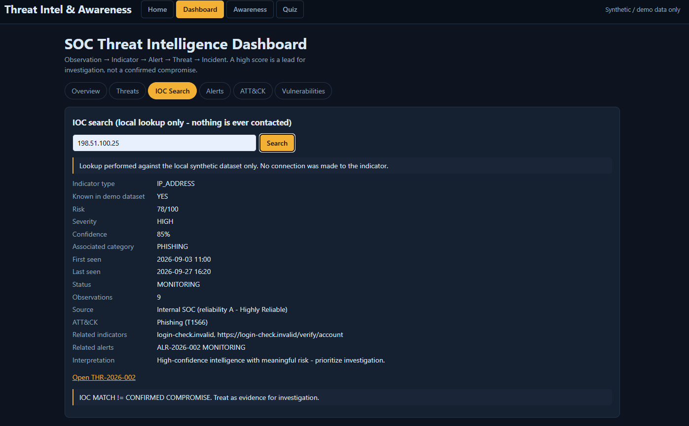
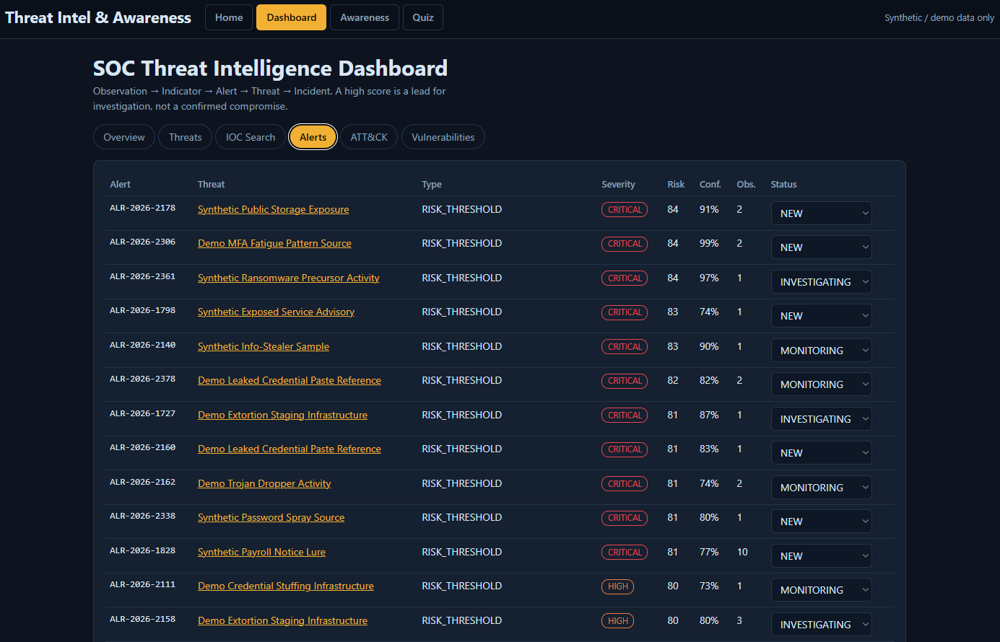
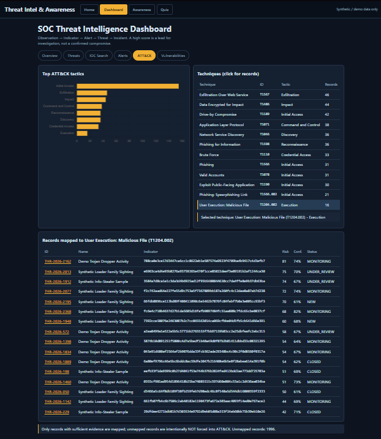
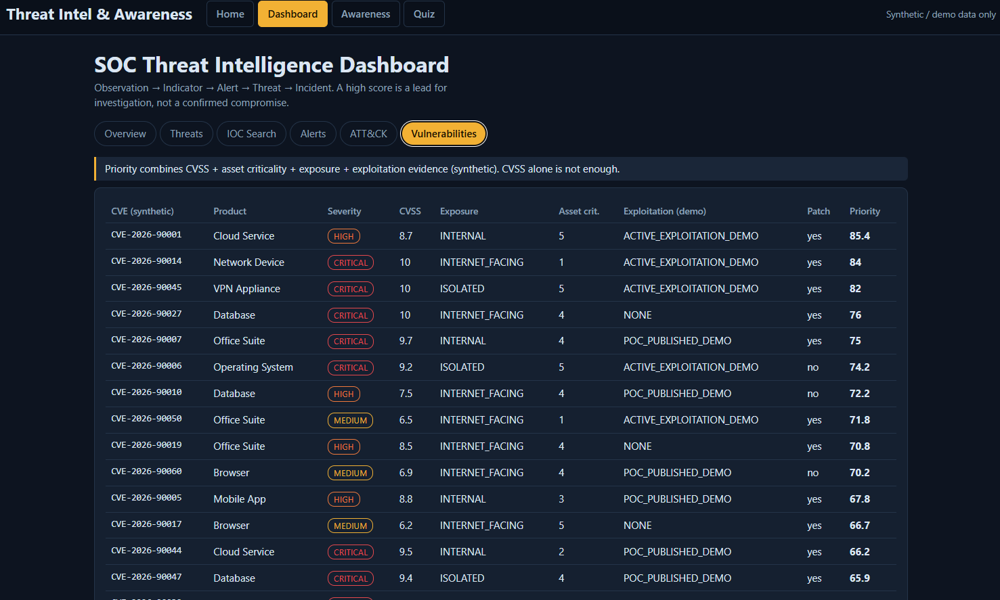
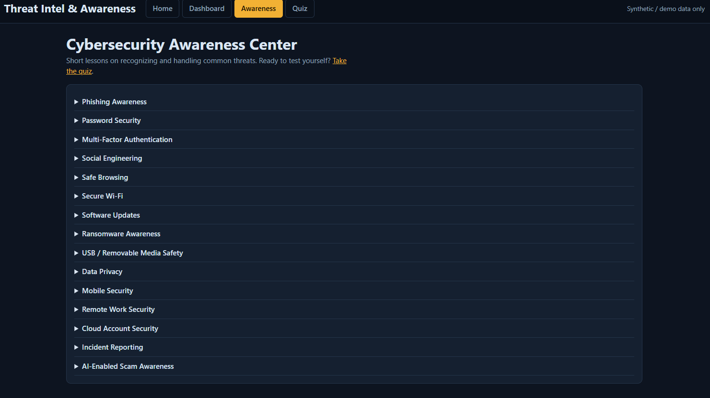
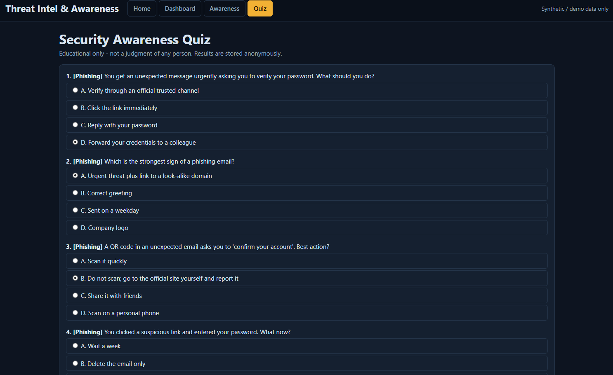
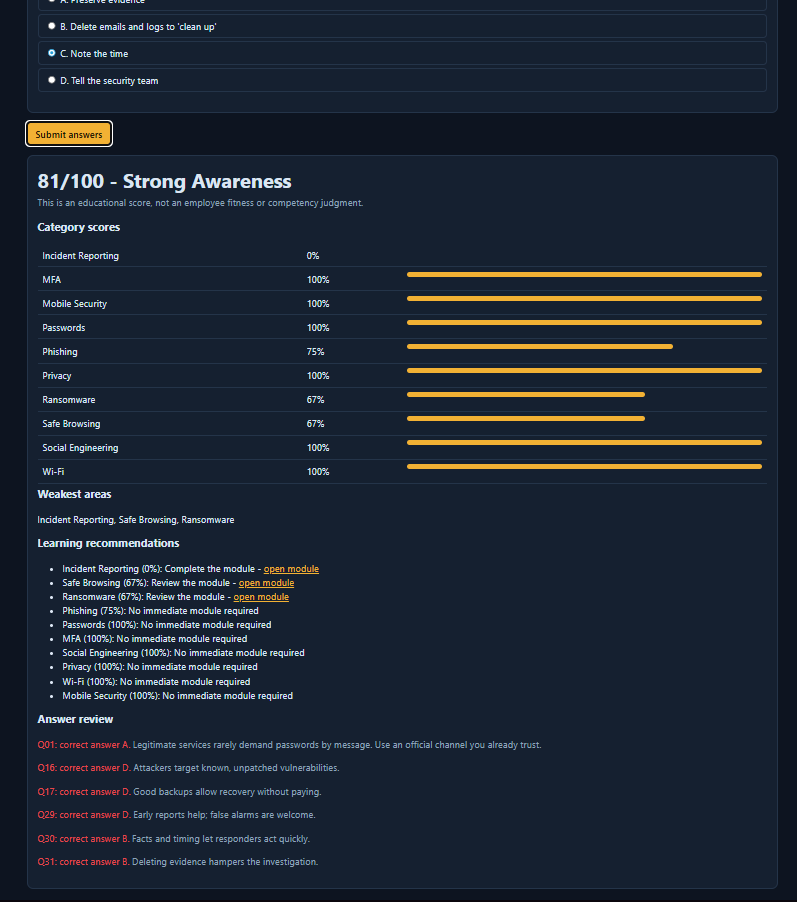

# Cybersecurity Awareness & Threat Intelligence Dashboard

> This project is designed exclusively for defensive cybersecurity education, threat-intelligence analysis, and security awareness. It does not execute, deploy, or interact with malicious payloads or unauthorized systems.

## Overview
A SOC-style dashboard that ingests **synthetic** threat intelligence (IOCs, CVEs, ATT&CK context), validates, enriches, scores (risk **and** confidence), correlates and alerts on it, and pairs it with an interactive **awareness center, quiz and personalized learning plan**. Works fully offline. Stack: Flask + SQLite + Pandas + Chart.js (no build step).

## Problem Statement
Threat feeds, CVE lists and awareness training live in separate tools, so teams struggle to prioritize and users rarely get relevant guidance. This project unifies them and keeps analysts honest: **an IOC match is not a confirmed compromise**.

## Objectives
Validate/normalize indicators · enrich from local data · score risk vs confidence · correlate related indicators · limit alert fatigue · map to ATT&CK only with evidence · prioritize vulnerabilities by context · teach users via modules and quizzes · summarize for executives.

## Features
Threat feed table with filters/sorting · IOC search (lookup only) · 10 dashboard charts · threat detail + timeline + notes · Observation/Indicator/Alert/Threat/Incident labels · alert queue with status workflow · ATT&CK tactic/technique drill-down · vulnerability prioritization · 15 awareness modules · 31-question quiz · awareness score · executive summary · API-key RBAC, rate limiting, audit log.

## Architecture
```
Synthetic data -> Ingestion -> Normalization -> IOC validation -> Enrichment -> Risk+Confidence
   -> Correlation -> [Threat DB | Alert engine | ATT&CK mapper] -> SOC dashboard -> Analyst
Awareness content -> Modules -> Quiz -> Awareness score -> Recommendations
```
Folders: `backend/services` (all engines), `backend/routes` (REST API), `backend/utils` (auth, sanitizing, rate limit), `frontend` (HTML/CSS/JS), `awareness` (module + quiz JSON), `data` (generator + CSVs), `tests`, `reports` (auto test report), `docs`, `screenshots`.

## Concepts (details in `docs/CONCEPTS.md`)
- **Threat intelligence types**: strategic, tactical, operational, technical. This project focuses on technical + tactical + awareness.
- **IOC analysis**: syntax validation only (`validate_indicator`); indicators are data and are **never contacted**.
- **Enrichment**: `enrich_indicator` adds first/last seen, category, scores, source reliability, related indicators/alerts, ATT&CK, notes from the local DB.
- **Risk score** (0-100) = severity 30% + confidence 25% + recency 15% + observations 10% + source reliability 10% + context 10%. **Confidence** (0-100) = source grade 40% + corroboration 25% + freshness 20% + context 15%. Risk 90 / confidence 25 = serious but weakly supported.
- **Correlation**: records sharing a campaign/CVE form a *related cluster* (not attribution). Repeated alerts merge into one alert with an observation count.
- **ATT&CK**: mapped only when confidence >= 60 and >= 2 observations. Verify IDs at attack.mitre.org (the framework is versioned).
- **Vulnerabilities**: priority = CVSS 35 + asset criticality 20 + exposure 20 + exploitation evidence 20 + patch actionability 5. CVEs are synthetic (`CVE-2026-9xxxx`).

## Installation
```bash
mkdir Cybersecurity-Awareness-Threat-Intelligence-Dashboard && cd $_      # or unzip the project
python -m venv venv && source venv/bin/activate      # Windows: venv\Scripts\activate
pip install -r requirements.txt
cp .env.example .env                                  # Windows: copy .env.example .env
python data/generate_threat_data.py                   # 2,400 synthetic threats + 60 CVEs
python -m backend.db --reset                          # build SQLite DB
python -m backend.app                                 # http://127.0.0.1:5000
```
Charts load Chart.js from a CDN (internet needed for charts only; the data and API are fully local).

## Usage walkthrough
1. Open http://127.0.0.1:5000 (executive summary) -> **SOC Dashboard**.
2. **Overview** tab: cards + charts. **Threats** tab: filter/sort; click a row for the investigation view.
3. **IOC Search**: try `198.51.100.25`, `login-check.invalid`, `CVE-2026-90001`.
4. Detail page **THR-2026-001**: scores, related indicators, timeline, ATT&CK (Initial Access / Phishing T1566), recommended actions. Add a note (key `demo-analyst-key`).
5. **ATT&CK** tab: click a technique to list its records. **Vulnerabilities** tab: compare CVSS vs priority.
6. **Awareness Center** -> **Quiz** -> view awareness score, weakest areas and recommendations.

## Demo scenario
THR-2026-001 *Synthetic Credential Phishing Campaign*: PHISHING, DOMAIN `login-check.invalid`, HIGH, risk 78, confidence 85, MONITORING, related IP `198.51.100.25` and a fictional URL. Do not visit anything.

## API
See `docs/API.md`. Reads are open in the demo; writes need `X-API-Key`.

## Testing
`python -m pytest -q` runs 37 tests and regenerates `reports/test_report.md` (Test ID, scenario, input, expected, actual, pass/fail).

## Security & Privacy
No outbound connections to indicators · input sanitization + output escaping (XSS) · API-key auth with RBAC · rate limiting · secrets in `.env` · security headers/CSP · audit log · anonymous quiz results · sender emails reduced to domains. Use HTTPS + a real identity provider in production; threat data can reveal detection gaps and should be access-controlled.

## Results
2,400 threat records, 60 vulnerabilities, ~190 merged alerts, evidence-gated ATT&CK mappings, 37/37 tests passing.

## Limitations
Synthetic data only, so it demonstrates workflow, not live intelligence. Scoring weights are teaching heuristics. Simple in-memory rate limiter and API keys. Correlation uses shared campaign/CVE only.

## Future Improvements
Authorized STIX/TAXII feeds, CISA KEV/EPSS-style prioritization, SIEM/SOAR integration, IOC expiry, ATT&CK Navigator export, Docker + CI/CD, role-based dashboards.

## Screenshots
### Home


### Dashboard overview


### Threats


### IOC search


### Alerts


### ATT&CK


### Vulnerabilities


### Awareness assessment


### Quiz


### Quiz results


See `docs/PORTFOLIO.md` for the screenshot checklist.

## Learning Outcomes
IOC handling, CTI concepts, risk vs confidence, correlation, alert-fatigue control, ATT&CK, vulnerability prioritization, secure API design, awareness program design.

## Ethical Disclaimer
Defensive education only; synthetic data; no scanning, exploitation, phishing pages or malware.

